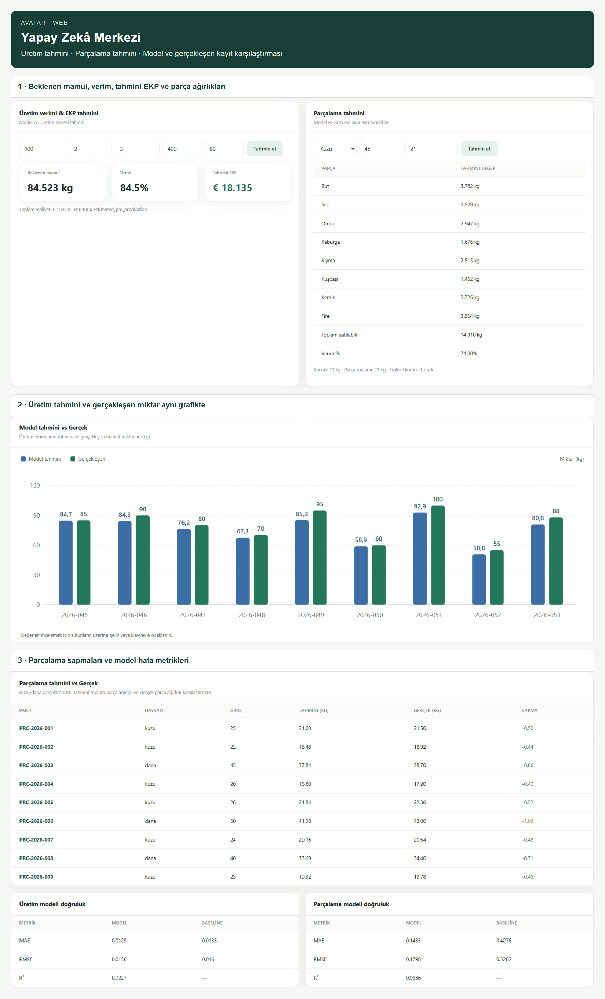
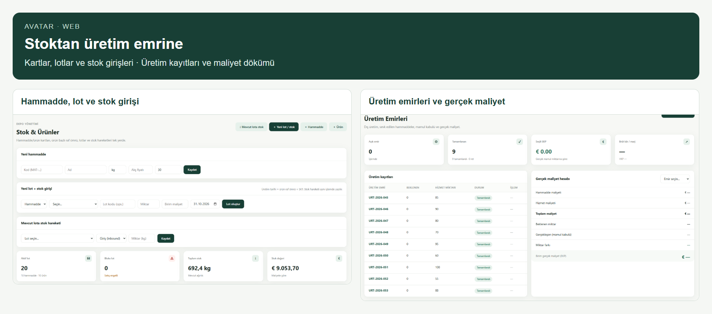
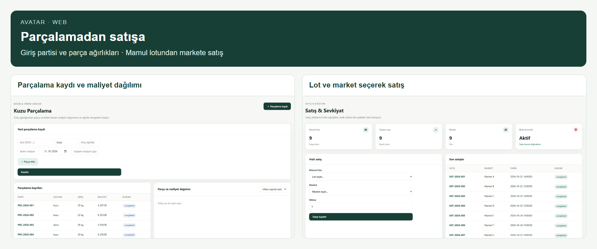
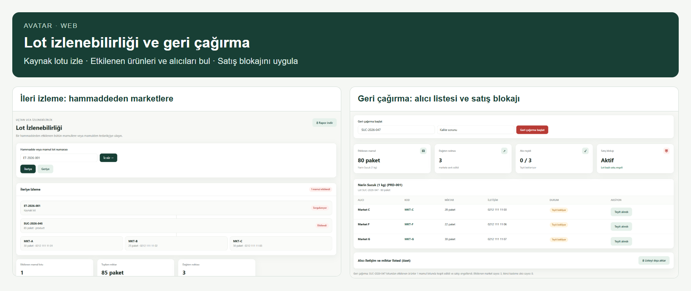
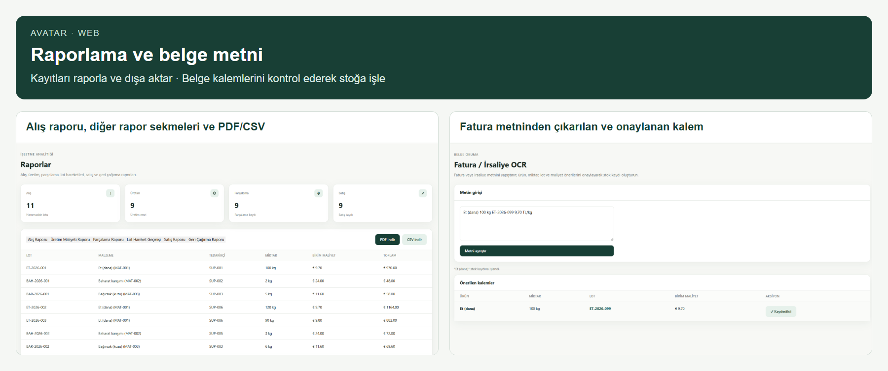
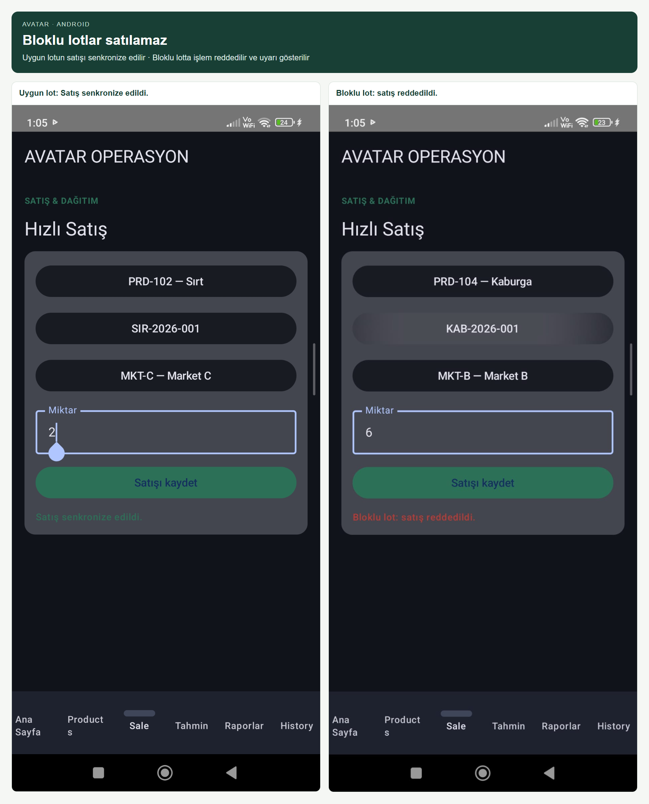
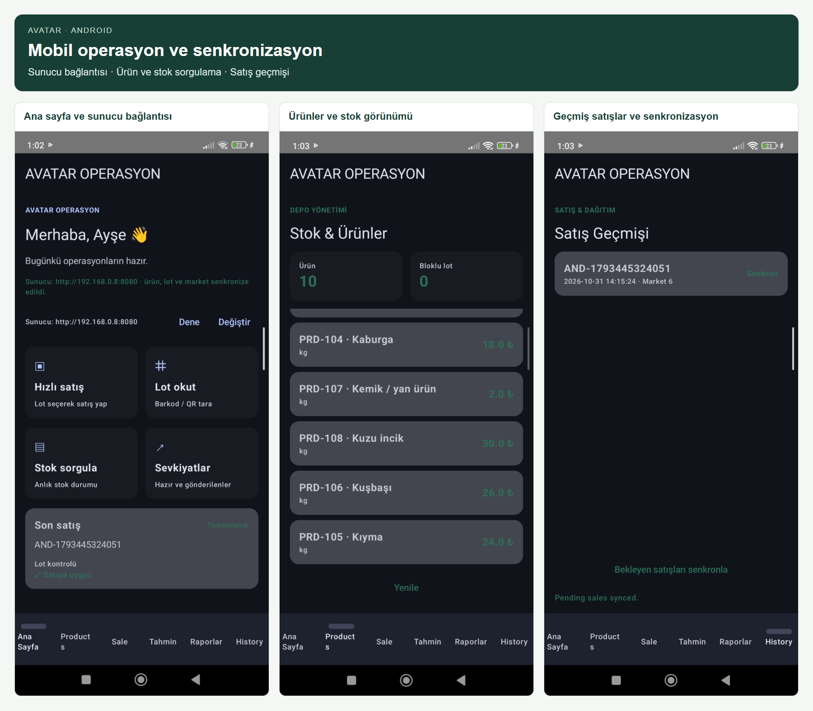
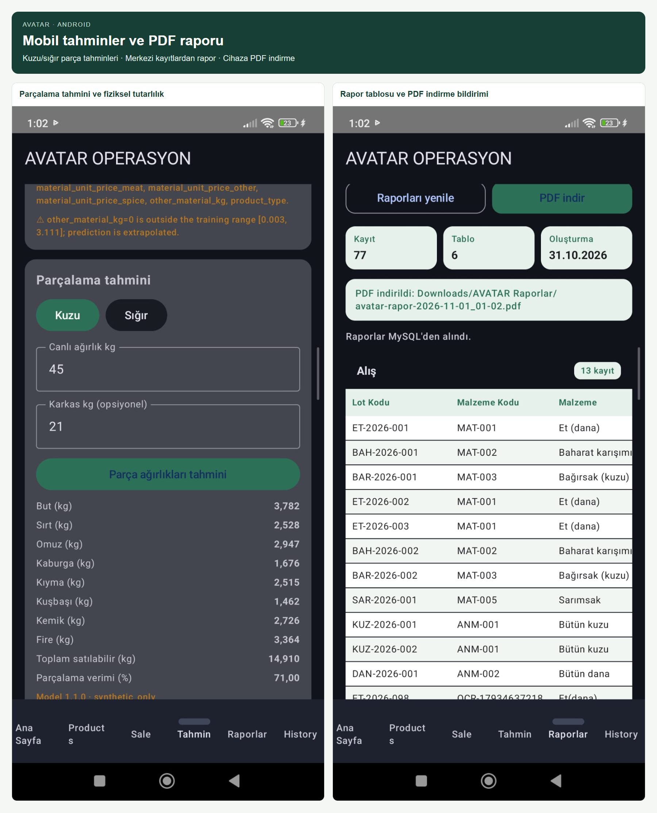
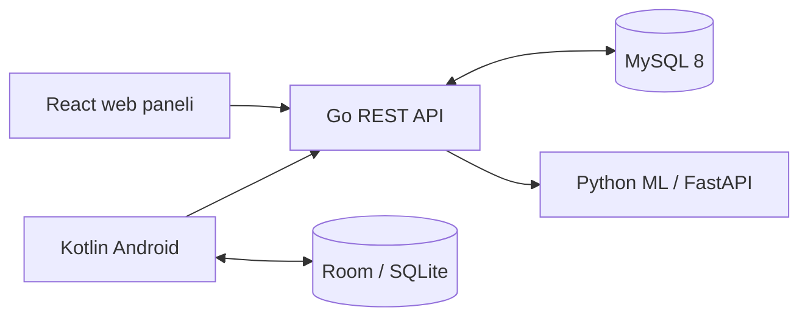

# AVATAR Food Intelligence · ALPHA-DUO

**Hammaddeden üretime, üretimden satışa kadar maliyet ve lot takibi.**

AVATAR; gıda işletmelerinin stok, dış üretim, parçalama, satış ve geri çağırma işlemlerini aynı kayıt zincirinde buluşturan bir yarışma prototipidir. React yönetim paneli, Kotlin Android uygulaması ve iki zorunlu ML görevi, Go API üzerinden birlikte çalışır.

[Kurulum](#kurulum) · [Ekranlar](#ekranlar) · [Demo senaryosu](#demo-senaryosu) · [Yapay zekâ ve veri](#yapay-zekâ-ve-veri) · [Dokümantasyon](#dokümantasyon)


## Proje neyi çözüyor?

Çalışma, [yarışma değerlendirme belgesindeki](ALPHA-DUO-Vault/AVATAR_Assessment.pdf) üç ana görevi ve iki yapay zekâ görevini temel alır.

| İhtiyaç | Uygulamadaki karşılığı |
|---|---|
| **Dış üretim ve gerçek maliyet** | Gönderilen hammadde lotları, hizmet bedeli, mamul kabulü ve miktar farkları kaydedilir. Fiili mamule göre EKP; satış fiyatı (VKP), birim brüt kâr ve marj hesaplanır. |
| **Kuzu parçalama ve satış** | Giriş ağırlığı, parça ürünleri, fire ve maliyet dağılımı izlenir. Miktar veya değer ağırlıklı dağıtım yapılır; oluşan ürünler lotlarıyla stoklanır ve satılır. |
| **İleri/geri izlenebilirlik** | Hammaddeden etkilenen mamullere ve kayıtlı alıcılara; mamulden kaynak lotlara, tedarikçilere ve üretim emirlerine ulaşılır. |
| **Geri çağırma** | Etkilenen lotlar bloke edilir, alıcı/miktar/iletişim listesi hazırlanır. Bloklu lotların satışı backend tarafından reddedilir. |
| **Üretim ve parçalama tahmini** | Beklenen mamul, verim, tahmini EKP ve parça ağırlıkları gösterilir; kayıtlı gerçekleşen miktarlarla karşılaştırılır. |
| **Mobil operasyon ve raporlama** | Yerel satış kaydı, senkronizasyon, stok sorgulama, tahmin geçmişi ve altı başlıkta raporlama sunulur. |

Lot bazında depo transferi, sevkiyat, iade ve yeniden işleme hareketleri desteklenir. Marketten alt alıcıya dağıtım, yalnızca kaydı varsa kesin olarak gösterilir.

## Ekranlar

### Web · Yapay zekâ tahmin sayfası



Üretim girdileriyle **beklenen mamul, verim ve tahmini EKP** hesaplanır. Kuzu veya sığır için karkas ağırlığına göre parça tahminleri alınır. Aynı sayfanın devamında üretim tahmini ile gerçekleşen miktar grafiği, parçalama sapmaları ve MAE/RMSE/R² tabloları bulunur. Böylece kullanıcı tahmini de gerçekleşen sonucu da birlikte değerlendirebilir.

Bu modeller sentetik veriyle eğitilmiştir; görsellerdeki metrikler gerçek işletme başarısı olarak yorumlanmamalıdır.

### Web · Stok yönetimi ve üretim emirleri



**Solda** hammadde kartı açma, yeni lot/stok girişi ve mevcut lota hareket ekleme işlemleri; **sağda** üretim kayıtları ve maliyet inceleme bölümü görülür. Bir emir seçildiğinde maliyet dökümü açılır. Hammadde ve mamul lotları üretim emrine bağlanır; kabul edilen fiili mamul miktarı üzerinden gerçek maliyet hesaplanır. Raf ömrü ve son tüketim tarihi de stok yönetiminin parçasıdır.

### Web · Parçalama ve lot bazında satış



Parçalama ekranında **giriş partisi, parça ürünleri, fiili ağırlıklar ve yan ürünler** kaydedilir; ağırlık dengesi, fire ve maliyet dağılımı incelenir. Satış ekranında mamul lotu, market ve miktar seçilir. Böylece hangi partiden çıkan ürünün hangi alıcıya satıldığı kayıt altında tutulur.

### Web · Lot izlenebilirliği ve geri çağırma



**Soldaki örnekte** `ET-2026-001` lotundan `SUC-2026-045` mamulüne ve marketlere giden kayıt zinciri görülür. **Sağdaki ayrı örnekte** `SUC-2026-047` için geri çağırma sonucu; etkilenen miktar, alıcılar, iletişim bilgileri ve aktif satış blokajı gösterilir. Sorunlu lotla ilişkili ürünler belirlenir ve bu lotların satışı engellenir.

İleri/geri izleme kesin kayıtlara dayanır. Alıcı teyit düğmesi ekran üzerindeki takip durumunu değiştirir; otomatik e-posta veya SMS göndermez.

### Web · Raporlar ve fatura kalemlerinin onaylanması



Rapor ekranında **alış, üretim maliyeti, parçalama, lot hareketleri, satış ve geri çağırma** kayıtları ayrı sekmelerde incelenir. CSV indirilebilir; yazdırma penceresinden PDF kaydedilebilir. Fatura/irsaliye ekranında yapıştırılan metinden ürün, miktar, lot ve maliyet önerileri çıkarılır; kalemler kullanıcı onayıyla stoğa işlenir. Mevcut belge akışı metin ayrıştırır; görselden otomatik OCR yapan ayrı bir motor içermez.

### Mobil · Bloklu lotlar satılamaz, kullanıcıya uyarı verilir



**Solda**, uygun lotun satışı sonrasında **“Satış senkronize edildi.”** mesajı görülür. **Sağda**, bloklu lot için yapılan denemede **“Bloklu lot: satış reddedildi.”** uyarısı gösterilir. Ürün, lot, market ve miktar seçimi aynı satış akışının parçasıdır; geri çağrılmış lotun satışı backend tarafından reddedilir.

### Mobil · Ana sayfa, stoklar ve satış geçmişi



Ana sayfada kullanılan sunucu adresi ve bağlantı sonucu görülür; **Dene / Değiştir** ile bağlantı kontrol edilir. Ürün-stok ekranı mevcut kayıtları gösterir. Satış geçmişinden yerel satışlar ve senkronizasyon durumu takip edilir, bekleyen satışlar yeniden gönderilebilir.

Room/SQLite çevrimdışı önbellek ve gönderim kuyruğudur. Bağlantı yokken satış yerelde bekler; sunucu kabul etmeden merkezi satış olarak kesinleşmez. Yeniden gönderimde sunucu blokaj kontrolü yapar ve aynı satış kodunun tekrar gönderilmesini denetler. Barkod/QR kısayolu mevcut prototipte simülasyondur.

### Mobil · Yapay zekâ tahmini ve PDF raporu



Mobil tahmin ekranında kuzu/sığır seçimi ve ağırlık bilgileriyle **parça miktarları, satılabilir toplam ve verim** görüntülenir. Raporlar ekranı merkezi kayıtları getirir; **PDF indir** ile dosya cihaza kaydedilir ve konumu kullanıcıya bildirilir. Tahmin için sunucu bağlantısı gerekir; çevrimdışıyken yeni tahmin üretilmez.

## Kurulum

### 1. Web, API ve ML servislerini başlatın

Docker Desktop ve Docker Compose gereklidir. Aşağıdaki komutları **proje kökünde**, PowerShell ile çalıştırın. `.env` yoksa örnek dosyadan oluşturun:

```powershell
Copy-Item .env.example .env
```

Servisleri derleyip başlatın:

```powershell
docker compose --env-file .env -f infra/docker-compose.yml up -d --build mysql ml backend web-m3
```

İlk derleme Python bağımlılıklarını kurar ve demo modellerini eğitir; biraz zaman alabilir. MySQL şeması ve örnek kayıtlar **ilk veritabanı oluşturulurken** yüklenir. Uygulama sonraki açılışlarda mevcut kayıtları kullanır.

| Adres | Kullanım |
|---|---|
| **[localhost:5174](http://localhost:5174)** | **Ana web arayüzü: Food Intelligence** |
| [localhost:8080/health](http://localhost:8080/health) | Go API sağlık kontrolü |
| [localhost:8080/ml/health](http://localhost:8080/ml/health) | ML bağlantısı ve yüklenen modeller |
| [localhost:8000/docs](http://localhost:8000/docs) | FastAPI servis dokümantasyonu |

Adresler varsayılan portlara göredir.

Kod güncel olduğu hâlde eski ekran görünüyorsa aynı `up -d --build` komutunu yeniden çalıştırın ve tarayıcıyı `Ctrl + F5` ile yenileyin.

<details>
<summary>İsteğe bağlı araçlar ve yerel geliştirme</summary>

Ham/API test paneli, veritabanı görüntüleyicisi ve SonarQube ayrıca başlatılabilir:

```powershell
docker compose --env-file .env -f infra/docker-compose.yml up -d --build web adminer sonarqube
```

- Ham yönetim paneli: `http://localhost:5173` — ana Food Intelligence panelinden ayrı bir giriş.
- Adminer: `http://localhost:8081` — varsayılan demo ayarlarıyla sunucu `mysql`, kullanıcı/veritabanı `avatar`, şifre `avatar`.
- SonarQube: `http://localhost:9000` — servis başlatmak taramayı otomatik çalıştırmaz; [tarama kılavuzunu](docs/sonarqube.md) izleyin.

Web'i Vite ile geliştirmek için Node.js 20+ kullanın:

```powershell
cd web
npm.cmd ci
npm.cmd run dev
```

Vite'ın terminalde gösterdiği adresin **`/m3.html`** yolunu açın. API ve ML servislerinin ayrıca çalışıyor olması gerekir. Docker ile başlatma bu ek ayarları gerektirmez.

ML'yi Python ortamında başlatacaksanız önce [model hazırlama ve çalıştırma adımlarını](docs/ml.md) uygulayın; model dosyası yoksa servis tahmin için `503` döner.

</details>

### 2. Android uygulamasını çalıştırın

Android Studio, JDK 17 ve Android SDK 34 gereklidir. SDK yolu `mobile/local.properties` içinde yerel makineye göre ayarlanır. API ve ML servisleri açıkken proje kökünden debug APK oluşturun:

```powershell
cd mobile
.\gradlew.bat :app:assembleDebug
adb install -r app/build/outputs/apk/debug/app-debug.apk
```

Ana ekrandaki **Sunucu → Değiştir** alanından bağlantıyı kontrol edin:

| Ortam | Backend adresi |
|---|---|
| Telefon ve bilgisayar aynı Wi-Fi ağında | `http://<PC-IP>:8080` |
| Android emülatörü | `http://10.0.2.2:8080` |
| USB bağlantısı | `adb reverse tcp:8080 tcp:8080` sonrası `http://127.0.0.1:8080` |

**Dene** ile bağlantıyı yeniden kontrol edebilirsiniz. Wi-Fi erişiminde bilgisayarın güvenlik duvarı 8080 portuna izin vermelidir. Ayrıntılar: [Android çalıştırma](docs/android.md).

> **Mevcut kurulum debug/demo içindir.** Debug sürümü yerel HTTP bağlantısına izin verir. Release sürümü HTTP'yi engeller; release için çalışan bir HTTPS backend adresi ve geçerli sertifika yapılandırması henüz tamamlanmamıştır.

## Demo senaryosu

Yarışma PDF'sindeki ana akış:

```text
ET-2026-001 · 100 kg et
        ↓
URT-2026-045 · dış üretim emri
        ↓
SUC-2026-045 · 85 adet 1 kg sucuk
        ↓
Market A: 30 · Market B: 25 · Market C: 30 paket
```

1. **Üretim Emirleri:** `URT-2026-045` kaydının girdilerini, mamul kabulünü ve gerçek maliyetini inceleyin.
2. **Lot İzlenebilirliği:** `ET-2026-001` için ileri izleme yapın; mamul lotunu ve market bağlantılarını bulun. `SUC-2026-045` için geri izlemeyi deneyin.
3. **Geri Çağırma:** kaynak lotu ve sebebi girin. Etkilenen lotlar bloke edilir, marketlerin miktar/iletişim listesi gösterilir.
4. **Android satış:** bloklu lot için satışın reddedildiğini, uygun bir lot için normal satış ve senkronizasyonu gösterin.
5. **Yapay Zekâ Merkezi:** üretim/parçalama tahmini alın ve kayıtlı gerçekleşen sonuçlarla karşılaştırın.

Geri çağırma demo verisinin durumunu değiştirir. Aynı kurulumda önceki satış ve geri çağırmalar varsa sonuçlar başlangıç örneğinden farklı olabilir.

<details>
<summary>PDF'deki maliyet hesabı ve parçalama tutarsızlıkları</summary>

| Maliyet unsuru | Hesap | Tutar |
|---|---|---:|
| Et | 100 kg × 9,70 € | 970,00 € |
| Baharat | 2 kg × 24,00 € | 48,00 € |
| Bağırsak | 5 kg × 11,60 € | 58,00 € |
| Hizmet | 85 paket × 5,50 € | 467,50 € |
| **Toplam** | | **1.543,50 €** |

**Gerçek EKP = 1.543,50 / 85 = 18,16 €/paket.** Hammadde bedelleri işletmeye ait olduğu için yalnızca hizmet faturasına bakılarak maliyet hesaplanmaz. Bu örnekte paketler 1 kg'dır; genel kullanımda paket ile kg birbirinin yerine geçirilmez.

Parçalama örneğinde **25 kg × 11,50 € = 287,50 €** eder; belgede anılan **351,00 €** ile aynı değildir. Parçaların **22 kg** toplamı da **3 kg** fark bırakır. Uygulama maliyet farkını ve ağırlık dengesini kontrol eder; bu değerleri sessizce birbirine eşitlemez.

</details>

## Yapay zekâ ve veri

| Görev | Nasıl çalışır? |
|---|---|
| **A · Üretim verimi ve EKP** | Et ve diğer üretim girdilerinden verim tahmin edilir. Beklenen mamul, et miktarı × tahmini verim ile; tahmini EKP ise maliyet hesabıyla türetilir. EKP ayrı bir ML hedefi değildir. |
| **B · Parçalama verimi** | Kuzu ve sığır için ayrı modeller parça ağırlıkları üretir. Parçalar ölçülmüş karkas ağırlığına dengelenir; satılabilir toplam ve verim bu parçalardan hesaplanır. |

**Model sürümü `1.1.0`; eğitim durumu `synthetic_only`.** Eğitimde 480 sentetik üretim kaydı, 800 kuzu ve 800 sığır kaydı kullanılır. Gerçek kamu ölçümleri bulunup ayrı referans tablolarına aktarılmıştır; ancak yarışmanın üretim/maliyet ve parça hedeflerini birlikte içermedikleri için eğitime karıştırılmamıştır.

Eğitim/test ayrımı üretim partisi veya çiftlik gruplarına göre yapılır. Model seçimi eğitim içi çapraz doğrulama ile yürütülür; ayrılan test verisinde MAE, RMSE, R² ve baseline karşılaştırması raporlanır. Bu metrikler **sentetik test başarısını** anlatır, gerçek işletme başarısını kanıtlamaz. Model kısıtları ve veri lisansları: [model kartı](docs/ml.md) · [veri kaynakları](docs/DATA_SOURCES.md).

Web ve mobil tahminleri Go API üzerinden alır. Model dosyaları API açılışında yüklenir; her tahmin isteğinde yeniden eğitim yapılmaz. ML servisine veya modele erişilemezse hata gösterilir.

**Lot izlenebilirliği, geri çağırma ve satış blokajı tahminlere değil, kesin kayıt ilişkilerine dayanır.**

## Mimari ve teknoloji



| Katman | Teknoloji ve sorumluluk |
|---|---|
| Web | React, TypeScript, Vite — yönetim, karşılaştırma ve raporlama |
| Mobil | Kotlin, Jetpack Compose, Room/SQLite — satış, önbellek ve gönderim kuyruğu |
| Backend | Go `net/http`, REST API — iş kuralları, stok, maliyet ve senkronizasyon |
| Merkezi veri | MySQL 8 — kalıcı ve merkezi kayıtlar |
| ML | Python 3.12, FastAPI, scikit-learn — eğitim, değerlendirme ve tahmin |
| Altyapı / kalite | Docker Compose, Nginx, SonarQube — servis çalıştırma ve statik analiz |

Merkezi kayıt kaynağı MySQL'dir; mobil SQLite bağımsız bir merkezi stok sistemi değildir. Senkronizasyonun veri modeli ve tekrar gönderim yaklaşımı [mobil senkronizasyon belgesinde](docs/mobile-sync.md) açıklanır.

<details>
<summary>Geliştiriciler için klasörler, API ve testler</summary>

```text
backend/              Go API, iş kuralları, MySQL şeması ve örnek kayıtlar
web/                  Ana Food Intelligence ve ham yönetim paneli
mobile/               Kotlin Android uygulaması
ml/                   Veri hazırlama, eğitim, değerlendirme ve FastAPI
infra/                Docker Compose ve SonarQube yapılandırması
docs/                 API, veri modeli, kurulum ve doğrulama belgeleri
web-arayuz-gorsel/    Web ekran görüntüleri
mobil-arayuz-gorsel/  Android ekran görüntüleri
ALPHA-DUO-Vault/      Yarışma PDF'si ve proje notları
```

Öne çıkan API yolları: `/production-orders`, `/butchery-batches`, `/lots`, `/trace/forward`, `/trace/backward`, `/recalls`, `/sales`, `/sync/pull`, `/sync/push` ve `/reports/summary`.

Tahminler: `POST /ml/predict/v2/yield`, `POST /ml/predict/v2/butchery`. Model raporu: `GET /ml/report`. Tam sözleşmeler: [API referansı](docs/api.md) ve [ML model kartı](docs/ml.md).

Temel kontroller proje kökünden çalıştırılabilir. Python bağımlılıkları ve Android SDK/JDK önceden kurulmuş olmalıdır:

```powershell
go -C backend test ./...
python -m pytest ml/tests ml/test_model.py -q
npm.cmd --prefix web ci
npm.cmd --prefix web run build
```

Android JVM testleri için `mobile/` içinde `.\gradlew.bat :app:testDebugUnitTest` çalıştırılır. MySQL entegrasyonu, Chrome testleri ve kapsam raporlarının üretimi için [ayrıntılı test/tarama adımlarını](docs/sonarqube.md) izleyin.

31 Ekim 2026 tarihli son kayıtlı SonarQube analizinde kalite kapısı geçti; genel kapsam **%62,0**, yeni kod kapsamı **%83,6** olarak ölçüldü. Bu iki oran farklıdır. Sonuç ve test sınırlılıkları [SonarQube raporunda](docs/SONARQUBE_REPORT.md) kayıtlıdır; statik analiz sonucu gerçek cihaz/release doğrulaması yerine geçmez.

</details>

## Dokümantasyon

| Belge | İçerik |
|---|---|
| [Yarışma PDF'si](ALPHA-DUO-Vault/AVATAR_Assessment.pdf) | Görevler, örnek kayıtlar ve değerlendirme ölçütleri |
| [Veri modeli](docs/data-model.md) · [ER diyagramı](docs/er-diagram.md) | Tablolar, lot ilişkileri ve veri yapısı |
| [API referansı](docs/api.md) | Servis yolları ve istek/yanıt sözleşmeleri |
| [Android kurulumu](docs/android.md) · [Senkronizasyon](docs/mobile-sync.md) | Cihaz bağlantısı, yerel kayıtlar ve veri aktarımı |
| [ML model kartı](docs/ml.md) · [Veri kaynakları](docs/DATA_SOURCES.md) | Modeller, sentetik/gerçek veri ayrımı, lisanslar ve sınırlılıklar |
| [ML inceleme ve düzeltmeler](docs/ML_AUDIT_AND_IMPROVEMENTS.md) | Model doğrulaması ve fiziksel tutarlılık kontrolleri |
| [SonarQube kılavuzu](docs/sonarqube.md) · [Sonuç raporu](docs/SONARQUBE_REPORT.md) | Test kapsamı, analiz adımları ve kayıtlı sonuçlar |
| [Güvenlik incelemesi](docs/SECURITY_REVIEW.md) | Container kullanıcıları ve Android geliştirme ayarları |
