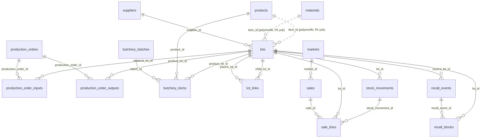

# ER Diyagramı — AVATAR ALPHA-DUO Veritabanı

MySQL 8, InnoDB. 17 tablo. PK: `BIGINT AUTO_INCREMENT`. Para `DECIMAL(12,2)`, miktar `DECIMAL(12,3)`.

## Mermaid diyagramı (Obsidian'da render edilir)



## Tablolar — PK / FK

| Tablo | PK | FK (→ hedef) | Açıklama |
|-------|----|--------------|----------|
| `materials` | `id` | — | Hammadde kartları |
| `products` | `id` | — | Mamul / parça ürünler |
| `suppliers` | `id` | — | Tedarikçiler |
| `markets` | `id` | — | Müşteri / marketler |
| `lots` | `id` | `supplier_id → suppliers.id` | Partiler (material/product) |
| `production_orders` | `id` | — | Üretim emirleri + hizmet maliyeti |
| `production_order_inputs` | `id` | `production_order_id → production_orders.id`, `material_lot_id → lots.id` | Emir girdileri |
| `production_order_outputs` | `id` | `production_order_id → production_orders.id`, `product_lot_id → lots.id` | Emir çıktıları |
| `butchery_batches` | `id` | — | Parçalama partileri |
| `butchery_items` | `id` | `batch_id → butchery_batches.id`, `product_id → products.id`, `product_lot_id → lots.id` | Parçalama ürünleri |
| `lot_links` | `id` | `parent_lot_id → lots.id`, `child_lot_id → lots.id` | İzlenebilirlik bağlantıları |
| `stock_movements` | `id` | `lot_id → lots.id` | Stok hareketleri |
| `sales` | `id` | `market_id → markets.id` | Satışlar |
| `sale_lines` | `id` | `sale_id → sales.id`, `lot_id → lots.id`, `stock_movement_id → stock_movements.id` | Satış satırları |
| `recall_events` | `id` | `source_lot_id → lots.id` | Geri çağırma olayları |
| `recall_blocks` | `id` | `recall_event_id → recall_events.id`, `lot_id → lots.id` | Bloke lotlar |
| `sync_outbox` | `id` | — | Mobil senkronizasyon kuyruğu |

> Not: `lots.item_id` çok-biçimli (material/product) olduğu için **FK taşımaz**; `item_type`
> sütunu hangi tabloya işaret ettiğini belirler (`material` → `materials`, `product` → `products`).

## İzlenebilirlik zinciri
```
lots(material) ──lot_links──▶ lots(product) ──stock_movements──▶ markets
                    │                                    │
                    └──── production_order_inputs ────────┘
```
İleri izleme: `lot_links` (parent→child) + `stock_movements` (shipment→market).
Geri izleme: `lot_links` (child→parent) + `lots.supplier_id`.
